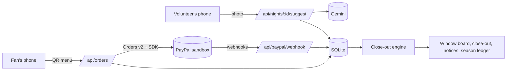

# Halftime

Halftime closes out a school booster club's concession stand. A volunteer photographs the stocked table before the game and the leftovers after it. Fans pay at the window with PayPal, Venmo or a card, and every order records its items. At the end of the night Halftime subtracts what PayPal sold from what left the table, which tells the treasurer how much cash should be in the box before anyone counts it.

Two volunteers then count the box without seeing that number, someone else records the bank deposit the next day, and any difference goes to the club's officers as a short notice with the figures.

Built for the [PayPal AI Hackathon](https://paypalaihackathon.devpost.com/). PayPal sandbox only; no real money moves.

## The problem

Booster clubs run the snack stand at almost every high school game in the US. Parents take turns staffing it, most sales are small and in cash, and afterwards nobody can say what the night should have made. Counting the box tells you what is in it. It can't tell you what should be there.

That gap shows up in police reports and state audits. In Hilliard, Ohio, police say a boosters' concessions treasurer withdrew more than $40,000 over two years while cash sales never matched deposits ([CW Columbus](https://cwcolumbus.com/news/local/allison-parkin-charged-stealing-40k-hilliard-bradley-athletic-boosters-treasurer-columbus-ohio-kristen-hosni)). In McKeesport, Pennsylvania, police said there was "no way to determine how much cash from concession stands is missing" ([CBS Pittsburgh](https://www.cbsnews.com/pittsburgh/news/mckeesport-marching-band-booster-organization-stealing-money/)). In DeKalb County, Tennessee, a band boosters treasurer was indicted in August 2026; $2,543.50 of the money was collected through Venmo and never deposited ([Tennessee Comptroller](https://comptroller.tn.gov/news/2026/8/10/former-dekalb-county-band-boosters-treasurer-indicted--after-misappropriating-more-than--48-000.html)).

Halftime is for the volunteer treasurer who inherits the cash box, usually a parent doing it for the first time.

## How it works

1. **Opening count.** One photo of the stocked table. Halftime suggests a count for each menu item and draws a numbered box on every unit it counted. The volunteer corrects it with +/− buttons and a second volunteer checks it. An item counted as 0 is not on sale that night.
2. **Selling.** Fans scan the booth QR code, pick items and pay. The server builds an itemized PayPal order from the club's own prices, captures it, reads it back from PayPal and shows a pickup code on the window tablet.
3. **Closing count.** One photo of what is left, plus anything dropped or given away. Saving it stops the buyer menu. For each item: sold = opened − left − waste, and cash = sold − units PayPal recorded.
4. **Recount check.** PayPal's records are exact, so they also check the photo count. If PayPal recorded more units of an item than the counts say were sold, Halftime asks for a recount of that item instead of reporting a cash difference. Recounts happen before the cash is counted: once the box has been counted, the closing count is locked, and anything still off needs a note when the night is finalized.
5. **Blind cash count.** Two volunteers count the box one after the other without seeing the expected amount or each other's number. Neither of them can be one of the two people who did the closing count, since the leftovers give away the expected amount. Green within $1, amber within $5, red beyond.
6. **Deposit.** The next day someone who did not count the cash enters the bank deposit. A difference creates a notice for the officers.
7. **Reimbursement.** The parent who bought the supplies is repaid with PayPal Payouts after an officer or the treasurer approves it.

The season page lists every game with PayPal sales, expected cash, counted cash, the deposit and both differences.

## Try it

```bash
git clone https://github.com/Abhinav0905/halftime.git
cd halftime
npm install
npm run dev            # http://localhost:3000
```

Node 22.13 or newer. No database setup: Halftime uses SQLite through Node's built-in driver and seeds a sample club with three past games on first run.

**Without any keys** the whole flow works. Payments run in a clearly labelled offline demo mode. On the count screens, **Use the demo photo** uploads a staged photo of a table from [public/demo/](public/demo/README.md), and the suggested count comes from its saved model answer in `eval/recorded/`. Any other photo is counted by hand.

**Staff PIN.** With `STAFF_PIN` unset, as on a fresh clone, every screen is open and the server logs a warning. Set it before sharing the URL: fans can still open the buyer menu and pay, and everything else asks for the PIN once per device at `/staff`. On a hosted demo, the PIN is in the testing instructions. Details are in [SECURITY.md](SECURITY.md).

**With PayPal sandbox keys** (`cp .env.example .env.local`, then fill in `PAYPAL_CLIENT_ID` and `PAYPAL_CLIENT_SECRET` from a sandbox REST app at developer.paypal.com) the buyer menu shows real PayPal, Venmo and card buttons. PayPal's [sandbox test cards](https://developer.paypal.com/tools/sandbox/card-testing/) work with the "Debit or Credit Card" button, so no buyer account is needed.

**With a Gemini API key** (`GEMINI_API_KEY`) the photo count runs live, up to 12 photos per game and 60 in all per hour so a loop can't drain the key. A retake of the same photo reuses the stored answer.

A short walkthrough: Start a game → photograph the table → open the QR link on a phone and pay → watch the window board → take the closing photo → enter two cash counts → record the deposit → check Notices and the Season ledger. Add `?decline=1` to the buyer menu URL to see a declined card (PayPal negative testing).

Every step asks who did it, picked from the sample club's roster, and the server checks the rules. One way through: Marcus Hill counts the opening table and Priya Shah checks it; at the end of the game Marcus and Priya count the leftovers; Jordan Lee and Dana Reyes count the cash; Pat Okafor records the deposit. The demo photos have no sports drinks, so the buyer menu leaves them out.

## How it's built

### PayPal

| What | API | Where |
|---|---|---|
| Itemized order for every sale: SKU, quantity, unit price, item total, `custom_id` = game and booth, `PayPal-Request-Id` so a double tap can't create two orders | Orders v2 create | [lib/paypal/payload.ts](lib/paypal/payload.ts), [lib/paypal/orders.ts](lib/paypal/orders.ts), [app/api/orders/route.ts](app/api/orders/route.ts) |
| Capture, then read the order back and store PayPal's own line items and total | Orders v2 capture and get | [app/api/orders/[id]/capture/route.ts](app/api/orders/[id]/capture/route.ts) |
| PayPal, Venmo and guest card buttons | JavaScript SDK (`@paypal/react-paypal-js`) | [components/BuyerMenu.tsx](components/BuyerMenu.tsx) |
| Refund a double charge; the units leave the PayPal column straight away | Payments v2 refund | [app/api/orders/[id]/refund/route.ts](app/api/orders/[id]/refund/route.ts) |
| Captures, refunds and payout updates that happen outside the app | Webhooks with `verify-webhook-signature`; events that don't verify are refused and not stored, verified ones are applied once per event id | [lib/paypal/webhooks.ts](lib/paypal/webhooks.ts) |
| Repay the supply buyer after an officer or the treasurer approves | Payouts, one `sender_batch_id` per try (the reimbursement id, then `<id>-2`…), so checking on a try PayPal never answered can't pay twice | [lib/paypal/payouts.ts](lib/paypal/payouts.ts), [lib/paypal/reimbursements.ts](lib/paypal/reimbursements.ts) |
| Declined card on camera | `PayPal-Mock-Response` negative testing | [lib/paypal/orders.ts](lib/paypal/orders.ts) |

Orders and Payments calls go through the [PayPal Server SDK](https://www.npmjs.com/package/@paypal/paypal-server-sdk), which APIMatic generates. Payouts and webhook verification are not in that SDK, so they use a small typed fetch client in [lib/paypal/client.ts](lib/paypal/client.ts). What happened when this ran against the sandbox, with order, capture, refund and payout IDs, is in [docs/sandbox-findings.md](docs/sandbox-findings.md).

### The photo count

This is the only place Halftime uses AI. Gemini 3.5 Flash gets the photo and a one-line description of each menu item and returns a count per item with a box per visible unit, as JSON checked against a zod schema ([lib/vision](lib/vision)). The volunteer sees the boxes and corrects the numbers, and a second volunteer checks them. The model never sees prices or money.

`npm run eval` scores the photo count against labelled photos ([eval/README.md](eval/README.md)).

### The close-out math

[lib/engine/reconcile.ts](lib/engine/reconcile.ts) is a set of pure functions over integer cents with no database or network access. Property tests ([tests/engine.test.ts](tests/engine.test.ts), fast-check) check that totals add up exactly, expected cash is never negative, refunded orders never count, and any item where PayPal exceeds the photo count is flagged. The separation-of-duties rules (checker ≠ counter, cash counters ≠ closing counters, second cash counter ≠ first, depositor ≠ cash counters, approver ≠ requester) live in [lib/engine/rules.ts](lib/engine/rules.ts). Every name is checked against the club roster on the server ([lib/roster.ts](lib/roster.ts)), and only officers and the treasurer can approve a payout.

### The app



Next.js 16 and TypeScript in strict mode, zod at every API boundary ([docs/api-contract.md](docs/api-contract.md) lists every route), SQLite through `node:sqlite`, Server-Sent Events for the window board, AG Grid Community for the season ledger. [render.yaml](render.yaml) deploys it to Render.

## Tests

```bash
npm run typecheck
npm test
npm run build
```

CI runs the same three steps on every push to `main` and on every pull request.

## Limits

- Sandbox only. Live payments would need a production PayPal app and a club account.
- No individual sign-in yet. An optional staff PIN (`STAFF_PIN`) keeps fans out of staff screens on a hosted demo; real roles per volunteer would come next.
- The photo count needs a flat, well-lit table photographed from above. Stacked or hidden items are undercounted, which is why a person always confirms.

## License

MIT, see [LICENSE](LICENSE).
